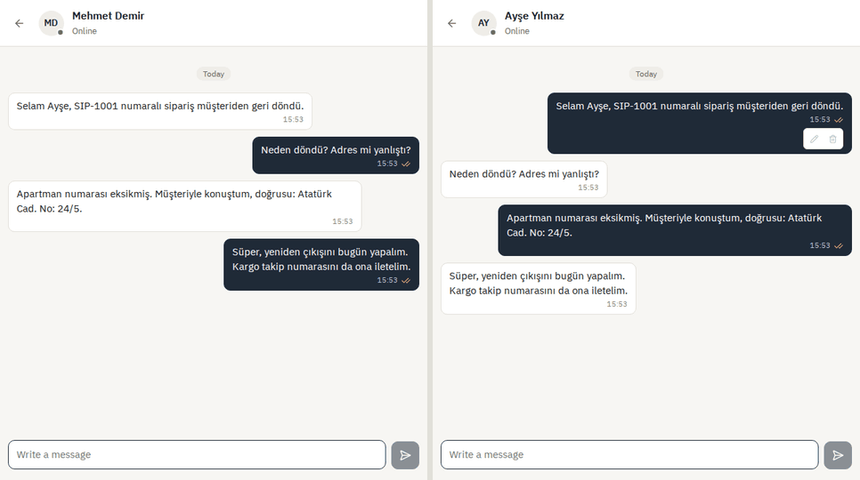
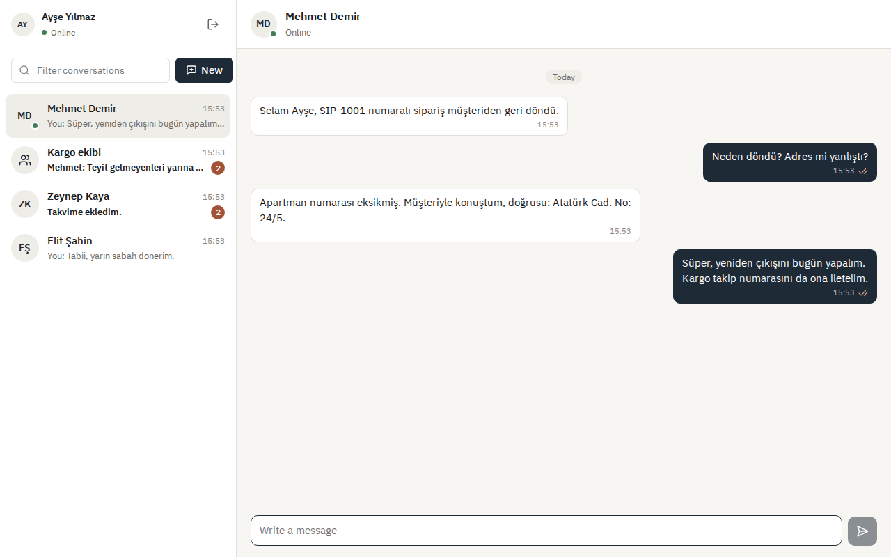
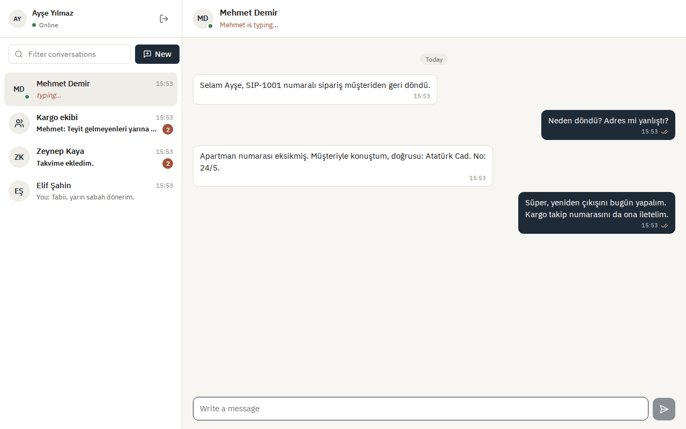
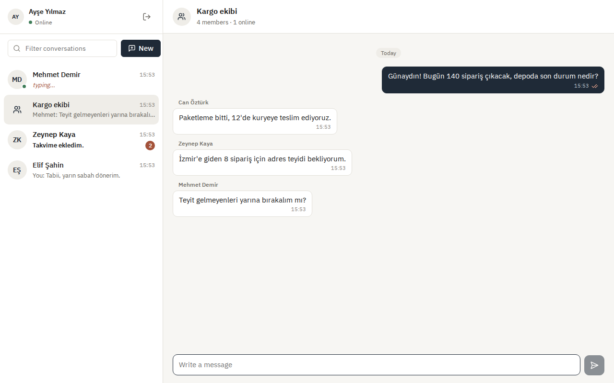
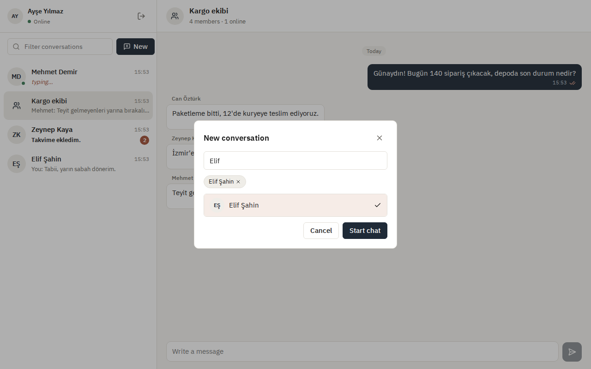
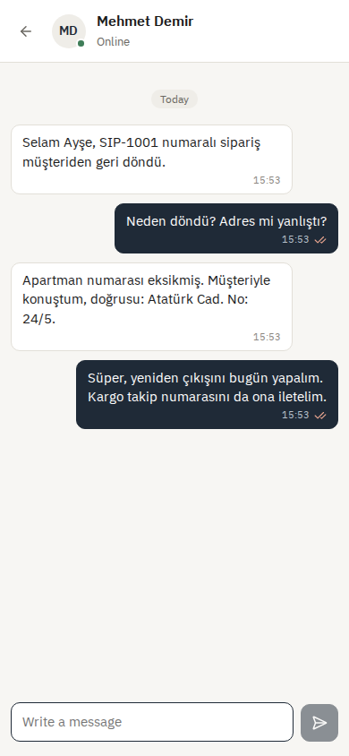
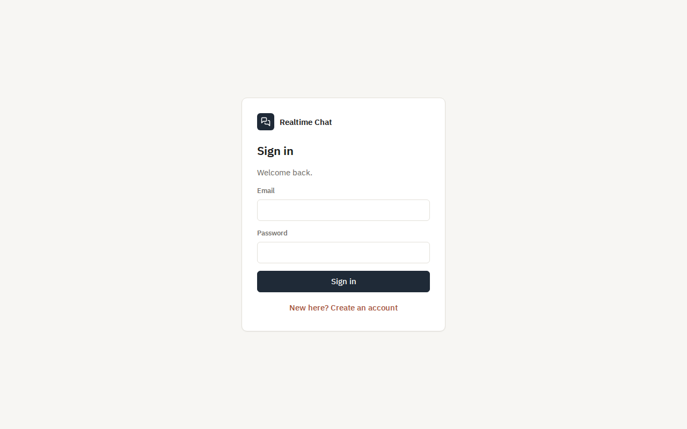
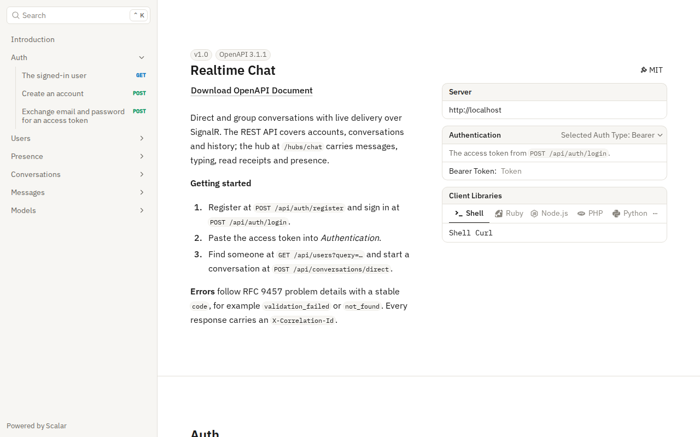
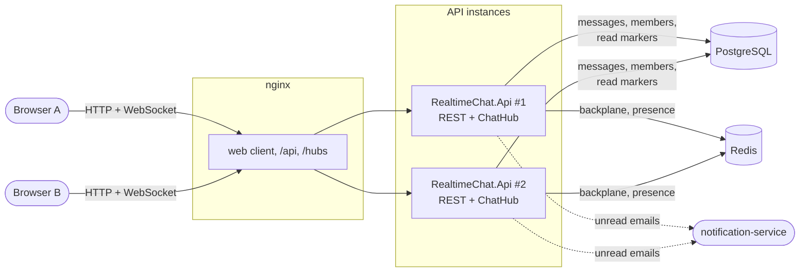

# Realtime Chat

**English** · [Türkçe](README.tr.md)

Direct and group chat with live delivery over SignalR. Every message has its place in its conversation (1, 2, 3, … with no gaps), so a client that drops off for a moment knows exactly what it missed and gets it back, in order, without duplicates. People see who is online, who is typing and who has read what. Two API instances run behind nginx and share a Redis backplane, and someone who stays offline gets one email about their unread messages through the [notification-service](https://github.com/Beratoguzhan620/notification-service).

[](https://github.com/Beratoguzhan620/realtime-chat/actions/workflows/ci.yml)




## Try it

```bash
docker compose up --build
```

This starts PostgreSQL, Redis, **two API instances** and nginx, which serves the web client and balances the API. Open http://localhost:8080 in two browsers (or a normal and a private window), create two accounts, find each other with *New* and start talking.

- API reference: http://localhost:8080/scalar
- The hub is at `/hubs/chat` (WebSockets, the access token as `access_token`).

## Features

- **Accounts:** registration and sign-in with JWT access tokens; passwords hashed with PBKDF2; a wrong email and a wrong password get the same answer; sign-in attempts are rate limited per address.
- **Conversations:** direct conversations (one per pair, even when both start one at the same moment) and groups of up to 100 people with an owner who adds people and renames the group. When the owner leaves, the longest-standing member takes over. People are found by part of their name or their whole email address; emails are never shown.
- **Messages:** sent over the hub (or REST for clients that cannot keep a connection open), up to 4000 characters, with line breaks. The sender may edit or delete; a deleted message keeps its place but loses its text. Sending is rate limited per person.
- **Ordering and catching up:** each message takes the next number of its conversation. History pages back with `before=n`; after a reconnect the client asks for everything `after=n` and fills any gap it notices.
- **No duplicates:** the client gives every message its own id. Sending it again after a timeout or a reconnect returns the stored message instead of a copy, even when two tabs race.
- **Read receipts and unread counts:** a read marker per member that only moves forward; the others see it at once (one tick, two ticks, or "read by 2 of 3" in groups).
- **Typing and presence:** "typing…" for the people in the conversation, online dots for the people you share a conversation with. Presence lives in Redis with expiring heartbeats, so several tabs count as one person and a crashed server does not leave anyone online for good.
- **Several instances:** the Redis backplane delivers hub events to people connected to any instance. Compose runs two behind nginx without sticky sessions.
- **Unread emails:** when a conversation has been quiet for ten minutes and a member who is offline has not read it, they get one email through the notification-service, not one per message.
- **Web client:** React and TypeScript. Conversation list with previews and unread badges, messages grouped by day and sender, pending and failed messages with retry, a reconnecting banner, empty, loading and error states, and a phone layout.

## Screenshots

| A conversation with read ticks | Typing on the other side |
|---|---|
|  |  |
| **A group** | **Starting a conversation** |
|  |  |
| **On a phone** | **Sign-in** |
|  |  |
| **The list on a phone** | **API reference** |
|  |  |

## Load test

Measured in CI on a standard GitHub runner by `tests/RealtimeChat.LoadTest`, against the Compose stack: nginx, two API instances, PostgreSQL and Redis, all on the same machine as the load client. 2,000 people in groups of 10 each hold a WebSocket open and send a message every 5 seconds for a minute.

| Measure | Result |
|---|---|
| Concurrent WebSocket connections | 2,000, opened in 2.6 s |
| Messages stored and numbered | 23,978 (400 per second), none failed |
| Deliveries to the other members | 215,802 of 215,802 (3,597 per second) |
| Send, from the call to the stored message | p50 5 ms · p95 42 ms · p99 137 ms |
| Delivery, from sending to every other member | p50 5 ms · p95 44 ms · p99 138 ms |

The first run had a p50 of 3.3 seconds and 158 sends failed. Two changes fixed it: two API instances with 100 pooled connections each had been running into PostgreSQL's default limit of 100 connections, and every send now takes its number and moves the sender's read marker in one statement, where it used three queries before.

## Tech stack

- ASP.NET Core 10: SignalR with a typed hub and a hub filter, minimal APIs, ProblemDetails, OpenAPI with Scalar, rate limiting, JWT bearer authentication
- PostgreSQL 17 with Entity Framework Core 10 (Npgsql), migrations, an atomic `UPDATE … RETURNING` for sequence numbers
- Redis 7: SignalR backplane (`Microsoft.AspNetCore.SignalR.StackExchangeRedis`) and presence with Lua scripts
- React 18, TypeScript and Vite; `@microsoft/signalr`; Lucide icons and IBM Plex
- nginx serving the client and balancing the API instances
- xUnit, Testcontainers (real PostgreSQL and Redis), two in-process API instances on one backplane, Vitest, Playwright
- GitHub Actions: warnings as errors, .NET and web tests, pending-migration check, Compose smoke test, two browsers chatting, the load test
- Docker / Docker Compose

## Architecture



Sending a message:

```mermaid
sequenceDiagram
    participant A as Ayşe (instance 1)
    participant H as ChatHub
    participant P as PostgreSQL
    participant R as Redis backplane
    participant M as Mehmet (instance 2)
    A->>H: Send(conversation, clientMessageId, body)
    H->>P: BEGIN; UPDATE conversations SET last_seq = last_seq + 1 RETURNING last_seq (+ sender's read marker)
    H->>P: INSERT message (seq); COMMIT
    Note over H,P: a resend hits the unique index: ROLLBACK gives the number back, the stored message is returned
    H-->>A: the stored message (seq 42)
    H->>R: MessageReceived to every member
    R->>M: MessageReceived (seq 42)
    Note over M: had 40? it asks for after=40 and fills the gap
```

## Design decisions

- **A number per conversation, taken in the database.** The next `seq` comes from one `UPDATE conversations … RETURNING last_seq` in the same transaction that stores the message. The row lock makes concurrent senders queue for it, a rolled-back send gives its number back, and the numbers have no gaps. That makes catching up trivial: "everything after 40", and a client that sees 42 after 40 knows to ask.
- **The client chooses the message id.** A unique index on (conversation, sender, client message id) turns a resend into a lookup. Clients can retry whenever they are unsure, which is exactly when networks fail; two copies racing each other end with one message.
- **PostgreSQL for what must survive, Redis for what is live.** Messages, members and read markers are durable. Presence and the backplane are not worth a database write per heartbeat, and losing Redis loses nothing that is not rebuilt in a minute.
- **Presence as expiring connections.** Each user has a sorted set of connection ids scored by when they expire. A connect, disconnect or heartbeat is one Lua script, so they cannot interleave. Two tabs count once, closing one changes nothing, and connections of a server that died disappear when they expire; a sweeper then tells their contacts.
- **Events go to users, not groups.** Hub events are sent to the member ids of the conversation (`Clients.Users`), so there are no SignalR groups to keep in sync with membership, and every tab and device of a person gets them on whichever instance it is connected to.
- **No sticky sessions.** The client connects with WebSockets directly and skips the negotiate request, so nginx may send a connection to any instance. The integration tests run two API instances on one Redis and check messages, typing, read receipts and presence across them.
- **New members do not inherit unread history.** Someone added to a group can read the history, but their read marker starts at the newest message, so they do not open the app to hundreds of unread messages.
- **One email per quiet conversation.** The unread-email job looks for conversations that have been quiet for a while, skips people who are online, and records the number it emailed about. Every instance may run it; the idempotency key (`conversation`, `user`, `seq`) makes the notification-service send each email once.
- **Messages are private.** Message bodies never reach the logs (the log enricher masks them, like tokens and passwords). Someone outside a conversation gets "not found" for it and its messages, never "forbidden", so ids cannot be probed. The web client renders messages as text and nginx sends a strict content security policy.
- **The client keeps its state in one reducer.** Every event (a message, an edit, a receipt, typing, presence) is an action on a pure reducer, so receiving the same message twice, out of order, or after a reconnect is tested without a browser.

## Commands

| Command | What it does |
|---|---|
| `docker compose up --build` | PostgreSQL, Redis, two API instances and nginx with the web client on http://localhost:8080 |
| `docker compose up --build --scale api=4` | The same with four API instances |
| `dotnet test` | .NET unit and integration tests (Docker needed for Testcontainers) |
| `cd web && npm install && npm test` | Web client unit tests (the state reducer) |
| `cd web && npm run dev` | The web client with hot reload on http://localhost:5173, against an API on port 8080 |
| `cd tests/e2e && npm install && node chat.mjs` | Two people chatting in two browsers against a running stack |
| `dotnet run -c Release --project tests/RealtimeChat.LoadTest -- 2000 10 60 5` | Load test against a running stack started with `AUTH_ATTEMPTS_PER_MINUTE=100000` |
| `dotnet ef migrations add <Name> --project src/RealtimeChat.Infrastructure --startup-project src/RealtimeChat.Api --output-dir Persistence/Migrations` | Add a migration |

Configuration for a local run, kept out of the repository:

```bash
dotnet user-secrets --project src/RealtimeChat.Api set "ConnectionStrings:Chat" "Host=localhost;Database=chat;Username=…;Password=…"
dotnet user-secrets --project src/RealtimeChat.Api set "ConnectionStrings:Redis" "localhost:6379"
dotnet user-secrets --project src/RealtimeChat.Api set "Jwt:SigningKey" "<at least 32 characters>"
```

Unread emails are off until `UnreadEmails:BaseUrl` and `UnreadEmails:ApiKey` point at a notification-service (in Compose: `NOTIFICATION_SERVICE_URL` and `NOTIFICATION_SERVICE_KEY`). Its template, `chat-unread` by default, gets `{{name}}`, `{{conversation}}` and `{{count}}`.

## Tests

69 tests and a browser flow: 15 .NET unit tests, 42 integration tests that run the real API (and a second instance) against PostgreSQL and Redis in Testcontainers with real SignalR clients over WebSockets, 10 Vitest tests for the web client's state, and a 14-step Playwright flow with two browsers against the Compose stack in CI.

- **Delivery:** a message reaches every connection of every member (two tabs of the same person included) and nobody else; new conversations are announced to the other people.
- **Ordering:** 45 messages sent at the same moment by three people get the numbers 1 to 45 exactly once, and every connection receives all of them.
- **No duplicates:** the same client message id over the hub, over REST and in five racing calls stores one message and notifies once.
- **Catching up:** messages sent while someone is disconnected come back with `after=n`, in order; history pages back without gaps or repeats.
- **Changes and access:** only the sender edits or deletes; outsiders cannot send, read or mark anything; empty and oversized messages are refused without using up a number; sending too fast is slowed down.
- **Read receipts:** the marker only moves forward, clears the unread count and reaches the other members.
- **Presence and typing:** online once for several tabs, offline with the last one, nothing for strangers; expired connections are swept (with a fake clock); typing reaches the others, not the typist, and is throttled.
- **Two instances:** messages, typing, read receipts and presence between people connected to different API instances.
- **Unread emails:** one email for an offline reader once the conversation is quiet, none for online or caught-up people, one more after new messages, with a stable idempotency key.
- **Web client (Vitest):** merging and deduplicating messages, finding gaps, unread counts, read ticks, typing expiry and presence in the reducer.
- **Browsers (CI):** registration, finding someone, a message arriving live with an unread badge, read ticks, typing, line breaks, editing, a reload, messages sent while away, the phone layout and no script errors.

## Roadmap and known gaps

- Attachments through object storage with signed URLs.
- Push notifications for the mobile apps, through the same notification-service.
- Refresh tokens; today the client signs in again when the hour-long access token expires.
- The send rate limit lives in each instance, so with N instances someone could send N times the rate; a Redis-based limit would close that.
- End-to-end encryption for direct conversations.

## License

[MIT](LICENSE) · Berat Oğuzhan Turğut · [GitHub](https://github.com/Beratoguzhan620)
