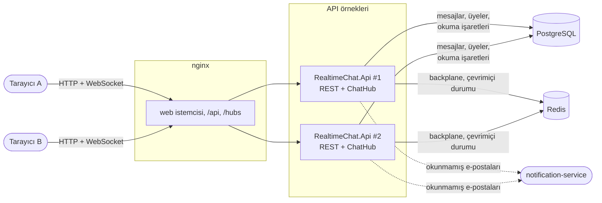

# Realtime Chat

[English](README.md) · **Türkçe**

SignalR ile anlık iletilen birebir ve grup sohbetleri. Her mesajın kendi sohbetinde bir yeri var (1, 2, 3, … boşluksuz). Bu yüzden bağlantısı bir an kopan istemci tam olarak neyi kaçırdığını bilir ve onları sırasıyla, tekrar olmadan geri alır. Kimin çevrimiçi olduğu, kimin yazdığı ve kimin neyi okuduğu görünür. İki API örneği nginx'in arkasında çalışır ve bir Redis backplane'i paylaşır. Çevrimdışı kalan kişiye okunmamış mesajları için [notification-service](https://github.com/Beratoguzhan620/notification-service) üzerinden tek bir e-posta gider.

[](https://github.com/Beratoguzhan620/realtime-chat/actions/workflows/ci.yml)


## Deneme

```bash
docker compose up --build
```

Bu komut PostgreSQL'i, Redis'i, **iki API örneğini** ve nginx'i başlatır. nginx web istemcisini sunar ve API'ye gelen istekleri dağıtır. http://localhost:8080 adresini iki tarayıcıda (ya da normal ve gizli pencerede) aç, iki hesap oluştur, *New* ile birbirinizi bulun ve yazışmaya başlayın.

- API belgesi: http://localhost:8080/scalar
- Hub adresi `/hubs/chat` (WebSockets; access token `access_token` olarak gönderilir).

## Özellikler

- **Hesaplar:** JWT access token ile kayıt ve giriş; parolalar PBKDF2 ile saklanır; yanlış e-posta ile yanlış parola aynı yanıtı alır; giriş denemeleri adres başına sınırlıdır.
- **Sohbetler:** birebir sohbetler (her çift için bir tane; ikisi aynı anda başlatsa bile) ve en fazla 100 kişilik gruplar. Grupların kişi ekleyip adı değiştirebilen bir sahibi vardır; sahip ayrılırsa en eski üye sahip olur. Kişiler adlarının bir kısmıyla ya da e-posta adreslerinin tamamıyla bulunur; e-postalar hiçbir zaman gösterilmez.
- **Mesajlar:** hub üzerinden gönderilir (bağlantı açık tutamayan istemciler için REST de var); en fazla 4000 karakter, satır sonlarıyla. Gönderen düzenleyebilir ya da silebilir; silinen mesaj yerini korur ama metnini kaybeder. Gönderim kişi başına hız sınırlıdır.
- **Sıra ve telafi:** her mesaj sohbetin bir sonraki numarasını alır. Geçmiş `before=n` ile geriye sayfalanır; yeniden bağlanınca istemci `after=n` ile sonrasını ister ve fark ettiği her boşluğu doldurur.
- **Mükerrer yok:** istemci her mesaja kendi id'sini verir. Zaman aşımından ya da yeniden bağlanmadan sonra tekrar gönderilen mesaj, kopya oluşturmak yerine kayıtlı mesajı döner; iki sekme yarışsa bile.
- **Okundu bilgisi ve okunmamış sayıları:** her üyenin yalnızca ileri giden bir okuma işareti var; diğerleri bunu anında görür (tek tik, çift tik ya da gruplarda "3 kişiden 2'si okudu").
- **Yazıyor bilgisi ve çevrimiçi durumu:** sohbetteki kişilere "yazıyor…", sohbet paylaştığın kişilere çevrimiçi noktası. Çevrimiçi durumu Redis'te süresi dolan heartbeat'lerle tutulur; birkaç sekme tek kişi sayılır, çöken bir sunucu kimseyi sonsuza kadar çevrimiçi bırakmaz.
- **Birden çok örnek:** Redis backplane, hub olaylarını hangi örneğe bağlı olursa olsun kişilere ulaştırır. Compose, nginx arkasında iki örneği sticky session olmadan çalıştırır.
- **Okunmamış mesaj e-postaları:** bir sohbet on dakikadır sessizse ve çevrimdışı bir üye onu okumamışsa, notification-service üzerinden tek bir e-posta alır; her mesaj için bir tane değil.
- **Web istemcisi:** React ve TypeScript. Önizlemeli ve okunmamış rozetli sohbet listesi; güne ve gönderene göre gruplanan mesajlar; tekrar denenebilen bekleyen ve gönderilemeyen mesajlar; yeniden bağlanma uyarısı; boş, yükleniyor ve hata durumları; telefon görünümü.

## Ekran görüntüleri

| Okundu tikleriyle bir sohbet | Karşı tarafta yazıyor bilgisi |
|---|---|
|  |  |
| **Bir grup** | **Sohbet başlatmak** |
|  |  |
| **Telefonda** | **Giriş** |
|  |  |
| **Telefonda liste** | **API belgesi** |
|  |  |

## Yük testi

CI'da, standart bir GitHub runner'ında `tests/RealtimeChat.LoadTest` ile Compose kurulumuna karşı ölçüldü: nginx, iki API örneği, PostgreSQL ve Redis, yük istemcisiyle aynı makinede. 10'luk gruplardaki 2.000 kişi birer WebSocket açık tutar ve bir dakika boyunca 5 saniyede bir mesaj gönderir.

| Ölçüm | Sonuç |
|---|---|
| Eş zamanlı WebSocket bağlantısı | 2.000, 2,6 saniyede açıldı |
| Kaydedilip numaralanan mesaj | 23.978 (saniyede 400), hiçbiri başarısız olmadı |
| Diğer üyelere iletim | 215.802'nin 215.802'si (saniyede 3.597) |
| Gönderim, çağrıdan kayıtlı mesaja | p50 5 ms · p95 42 ms · p99 137 ms |
| İletim, gönderimden diğer her üyeye | p50 5 ms · p95 44 ms · p99 138 ms |

İlk çalıştırmada p50 3,3 saniyeydi ve 158 gönderim başarısız olmuştu. İki değişiklik bunu düzeltti: her biri 100 bağlantılık havuz tutan iki API örneği PostgreSQL'in varsayılan 100 bağlantı sınırına takılıyordu. Ayrıca artık her gönderim, numara almayı ve gönderenin okuma işaretini ilerletmeyi tek bir ifadede yapıyor; önceden bunun için üç sorgu gidiyordu.

## Teknolojiler

- ASP.NET Core 10: tipli hub ve hub filtresiyle SignalR, minimal API, ProblemDetails, Scalar ile OpenAPI, hız sınırlama, JWT bearer kimlik doğrulama
- PostgreSQL 17 ve Entity Framework Core 10 (Npgsql), migration'lar, sıra numaraları için atomik `UPDATE … RETURNING`
- Redis 7: SignalR backplane'i (`Microsoft.AspNetCore.SignalR.StackExchangeRedis`) ve Lua betikleriyle çevrimiçi durumu
- React 18, TypeScript ve Vite; `@microsoft/signalr`; Lucide ikonları ve IBM Plex
- İstemciyi sunan ve API örneklerine yük dağıtan nginx
- xUnit, Testcontainers (gerçek PostgreSQL ve Redis), aynı backplane'de süreç içinde çalışan iki API örneği, Vitest, Playwright
- GitHub Actions: uyarılar hata sayılır, .NET ve web testleri, bekleyen migration kontrolü, Compose duman testi, iki tarayıcıda sohbet, yük testi
- Docker / Docker Compose

## Mimari



Bir mesajın gönderilmesi:

```mermaid
sequenceDiagram
    participant A as Ayşe (örnek 1)
    participant H as ChatHub
    participant P as PostgreSQL
    participant R as Redis backplane
    participant M as Mehmet (örnek 2)
    A->>H: Send(sohbet, clientMessageId, metin)
    H->>P: BEGIN; UPDATE conversations SET last_seq = last_seq + 1 RETURNING last_seq (+ gönderenin okuma işareti)
    H->>P: mesajı ekle (seq); COMMIT
    Note over H,P: tekrar gönderim benzersiz indekse takılır: ROLLBACK numarayı geri verir, kayıtlı mesaj döner
    H-->>A: kayıtlı mesaj (seq 42)
    H->>R: her üyeye MessageReceived
    R->>M: MessageReceived (seq 42)
    Note over M: elinde 40 mı var? after=40 ister ve boşluğu doldurur
```

## Tasarım kararları

- **Sohbet başına bir numara, veritabanında alınır.** Bir sonraki `seq`, mesajı kaydeden transaction'ın içinde tek bir `UPDATE conversations … RETURNING last_seq` ile alınır. Satır kilidi aynı anda gönderenleri sıraya koyar; geri alınan gönderim numarasını geri verir; numaralarda boşluk olmaz. Bu da telafiyi kolaylaştırır: "40'tan sonraki her şey". 40'tan sonra 42'yi gören istemci neyi isteyeceğini bilir.
- **Mesaj id'sini istemci seçer.** (sohbet, gönderen, istemci mesaj id'si) üzerindeki benzersiz indeks, tekrar gönderimi bir aramaya çevirir. İstemci emin olmadığı her an tekrar deneyebilir; ağların koptuğu an da tam olarak budur. Birbiriyle yarışan iki kopya tek mesajla sonuçlanır.
- **Kalıcı olması gerekenler PostgreSQL'de, anlık olanlar Redis'te.** Mesajlar, üyeler ve okuma işaretleri kalıcıdır. Çevrimiçi durumu ve backplane her heartbeat'te bir veritabanı yazmasına değmez; Redis'in kaybolması, bir dakika içinde yeniden kurulmayan hiçbir şeyi kaybettirmez.
- **Süresi dolan bağlantılarla çevrimiçi durumu.** Her kullanıcının, bağlantı id'lerini sona erme zamanlarına göre sıralayan bir sorted set'i var. Bağlanma, ayrılma ve heartbeat birer Lua betiğidir; birbirlerinin arasına giremezler. İki sekme bir sayılır, birini kapatmak bir şey değiştirmez, ölen bir sunucunun bağlantıları süreleri dolunca kaybolur; ardından bir süpürücü bu kişilerin tanıdıklarına haber verir.
- **Olaylar gruplara değil kullanıcılara gider.** Hub olayları sohbetin üye id'lerine gönderilir (`Clients.Users`). Böylece üyelikle senkron tutulacak SignalR grupları yoktur ve kişinin bütün sekme ve cihazları, hangi örneğe bağlı olurlarsa olsunlar olayları alır.
- **Sticky session yok.** İstemci doğrudan WebSockets ile bağlanır ve negotiate isteğini atlar; nginx bir bağlantıyı herhangi bir örneğe gönderebilir. Entegrasyon testleri aynı Redis'te iki API örneği çalıştırır ve aralarındaki mesajları, yazıyor bilgisini, okundu bilgisini ve çevrimiçi durumunu kontrol eder.
- **Yeni üyeler okunmamış geçmişi devralmaz.** Gruba eklenen kişi geçmişi okuyabilir ama okuma işareti en yeni mesajdan başlar; uygulamayı açtığında yüzlerce okunmamış mesajla karşılaşmaz.
- **Sessiz sohbet başına tek e-posta.** Okunmamış e-posta işi bir süredir sessiz olan sohbetleri bulur, çevrimiçi olanları atlar ve e-posta gönderdiği numarayı kaydeder. Her örnek bu işi çalıştırabilir; idempotency anahtarı (`sohbet`, `kullanıcı`, `seq`) sayesinde notification-service her e-postayı bir kez gönderir.
- **Mesajlar özeldir.** Mesaj metinleri loglara hiç ulaşmaz (log zenginleştirici onları da token ve parolalar gibi maskeler). Sohbetin dışındaki biri sohbet ve mesajları için "yasak" değil "bulunamadı" alır; id'ler yoklanamaz. Web istemcisi mesajları metin olarak gösterir, nginx sıkı bir içerik güvenlik politikası gönderir.
- **İstemci durumunu tek bir reducer'da tutar.** Her olay (mesaj, düzenleme, okundu bilgisi, yazıyor, çevrimiçi) saf bir reducer'a bir eylemdir. Aynı mesajın iki kez, sırasız ya da yeniden bağlanmadan sonra gelmesi tarayıcı olmadan test edilir.

## Komutlar

| Komut | Ne yapar |
|---|---|
| `docker compose up --build` | PostgreSQL, Redis, iki API örneği ve web istemcisiyle nginx, http://localhost:8080 |
| `docker compose up --build --scale api=4` | Aynısı, dört API örneğiyle |
| `dotnet test` | .NET birim ve entegrasyon testleri (Testcontainers için Docker gerekir) |
| `cd web && npm install && npm test` | Web istemcisinin birim testleri (durum reducer'ı) |
| `cd web && npm run dev` | Anlık yenilemeli web istemcisi, http://localhost:5173, 8080 portundaki API'ye karşı |
| `cd tests/e2e && npm install && node chat.mjs` | Çalışan kuruluma karşı iki tarayıcıda sohbet eden iki kişi |
| `dotnet run -c Release --project tests/RealtimeChat.LoadTest -- 2000 10 60 5` | `AUTH_ATTEMPTS_PER_MINUTE=100000` ile başlatılmış kuruluma karşı yük testi |
| `dotnet ef migrations add <Ad> --project src/RealtimeChat.Infrastructure --startup-project src/RealtimeChat.Api --output-dir Persistence/Migrations` | Migration ekler |

Yerelde çalıştırmak için ayarlar; repoya girmezler:

```bash
dotnet user-secrets --project src/RealtimeChat.Api set "ConnectionStrings:Chat" "Host=localhost;Database=chat;Username=…;Password=…"
dotnet user-secrets --project src/RealtimeChat.Api set "ConnectionStrings:Redis" "localhost:6379"
dotnet user-secrets --project src/RealtimeChat.Api set "Jwt:SigningKey" "<en az 32 karakter>"
```

Okunmamış mesaj e-postaları, `UnreadEmails:BaseUrl` ve `UnreadEmails:ApiKey` bir notification-service'i gösterene kadar kapalıdır (Compose'da `NOTIFICATION_SERVICE_URL` ve `NOTIFICATION_SERVICE_KEY`). Şablonu (varsayılan `chat-unread`) `{{name}}`, `{{conversation}}` ve `{{count}}` değişkenlerini alır.

## Testler

69 test ve bir tarayıcı akışı: 15 .NET birim testi; gerçek API'yi (ve ikinci bir örneği) Testcontainers'taki PostgreSQL ve Redis'e karşı, WebSockets üzerinden gerçek SignalR istemcileriyle çalıştıran 42 entegrasyon testi; web istemcisinin durumu için 10 Vitest testi ve CI'da Compose kurulumuna karşı iki tarayıcıyla 14 adımlık bir Playwright akışı.

- **İletim:** mesaj her üyenin her bağlantısına (aynı kişinin iki sekmesi dahil) ulaşır, başka kimseye ulaşmaz; yeni sohbetler diğer kişilere duyurulur.
- **Sıra:** üç kişinin aynı anda gönderdiği 45 mesaj 1'den 45'e kadar numaraları birer kez alır ve her bağlantı hepsini alır.
- **Mükerrer yok:** aynı istemci mesaj id'si hub üzerinden, REST üzerinden ve yarışan beş çağrıda tek mesaj kaydeder ve bir kez bildirir.
- **Telafi:** bağlantı yokken gönderilen mesajlar `after=n` ile sırasıyla geri gelir; geçmiş boşluksuz ve tekrarsız geriye sayfalanır.
- **Değişiklik ve erişim:** yalnızca gönderen düzenler ya da siler; dışarıdakiler gönderemez, okuyamaz, işaretleyemez; boş ve fazla uzun mesajlar numara harcamadan reddedilir; çok hızlı gönderim yavaşlatılır.
- **Okundu bilgisi:** işaret yalnızca ileri gider, okunmamış sayısını sıfırlar ve diğer üyelere ulaşır.
- **Çevrimiçi durumu ve yazıyor bilgisi:** birkaç sekme için bir kez çevrimiçi, sonuncusuyla çevrimdışı, yabancılara hiçbir şey; süresi dolan bağlantılar (sahte saatle) süpürülür; yazıyor bilgisi yazana değil diğerlerine gider ve sıklığı sınırlanır.
- **İki örnek:** farklı API örneklerine bağlı kişiler arasında mesajlar, yazıyor bilgisi, okundu bilgisi ve çevrimiçi durumu.
- **Okunmamış e-postaları:** sohbet sessizleşince çevrimdışı okuyucuya tek e-posta, çevrimiçi ya da okumuş olanlara hiç, yeni mesajlardan sonra bir tane daha; sabit bir idempotency anahtarıyla.
- **Web istemcisi (Vitest):** reducer'da mesajları birleştirme ve tekrarları ayıklama, boşlukları bulma, okunmamış sayıları, okundu tikleri, yazıyor bilgisinin süresi ve çevrimiçi durumu.
- **Tarayıcılar (CI):** kayıt, birini bulma, okunmamış rozetiyle anında gelen mesaj, okundu tikleri, yazıyor bilgisi, satır sonları, düzenleme, sayfa yenileme, yokken gönderilen mesajlar, telefon görünümü ve hiç script hatası olmaması.

## Yol haritası ve bilinen eksikler

- İmzalı URL'lerle nesne depolama üzerinden dosya ekleri.
- Mobil uygulamalar için aynı notification-service üzerinden push bildirimleri.
- Refresh token'lar; şu an bir saatlik access token'ın süresi dolunca istemci yeniden giriş yapar.
- Gönderim hız sınırı her örnekte ayrı tutuluyor; N örnekle biri N katı hızda gönderebilir. Redis tabanlı bir sınır bunu kapatır.
- Birebir sohbetler için uçtan uca şifreleme.

## Lisans

[MIT](LICENSE) · Berat Oğuzhan Turğut · [GitHub](https://github.com/Beratoguzhan620)
